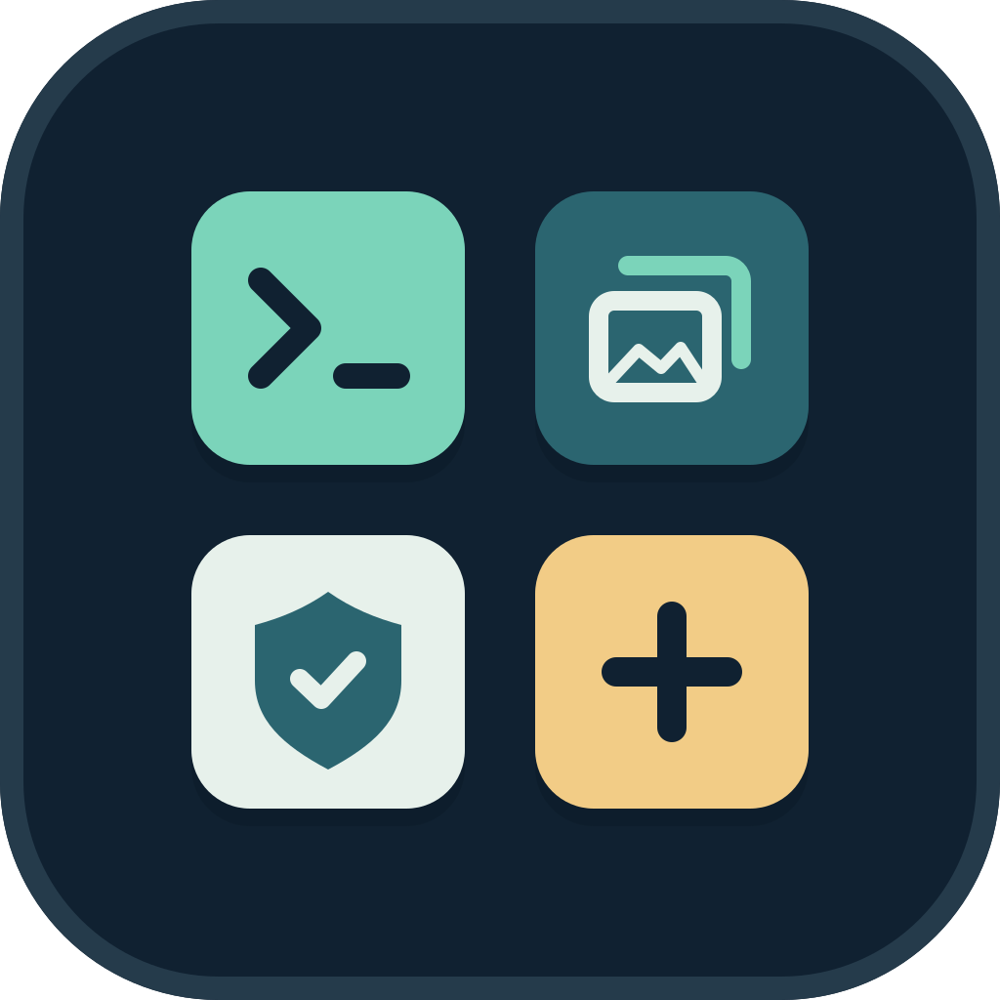
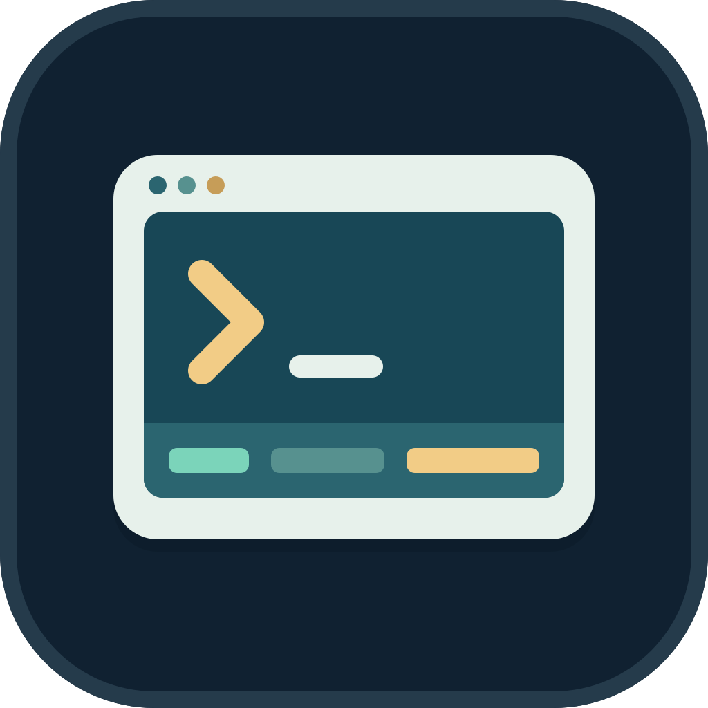

# neocc-mods



[English](README.md) | Русский

Коллекция модов для Claude Code. Каждый мод лежит в своей папке и является отдельным
плагином (`.claude-plugin/plugin.json` и модуль с хуками).

| Мод | Что делает |
| --- | --- |
|  [`neo-statusline`](./neo-statusline) | Статусбар в одну строку под промптом: модель, режим мышления, git, контекст, prompt cache, лимиты, стоимость |
|  [`neo-screenshots`](./neo-screenshots) | История изображений из Read и MCP с поиском и открытием сохранённых снимков в системном просмотрщике |
|  [`budget-guard`](./budget-guard) | Поддержание prompt cache, предупреждения о лимитах и контексте, подтверждение запроса с холодным кэшем |

## Установка

В строке ввода Claude Code выберите нужный мод:

```text
/plugin install neo-statusline --marketplace Hoxiee/claude-code-mods
/plugin install neo-screenshots --marketplace Hoxiee/claude-code-mods
/plugin install budget-guard --marketplace Hoxiee/claude-code-mods
```

Подтвердите добавление marketplace клавишей `y`, затем выберите область установки
и настройки. Требования и управление описаны в README каждого мода. При включённом
keepalive `budget-guard` делает фоновые запросы к модели, которые расходуют лимиты.

## Подключение локальной копии

Укажите папку мода в `CLAUDE_CODE_PLUGIN_DIRS` в `~/.claude/settings.json`. За папкой
идёт слежение, поэтому правки перезагружают мод прямо во время сессии.

```json
{
  "env": { "CLAUDE_CODE_PLUGIN_DIRS": "/path/to/neocc-mods/neo-statusline" }
}
```

Несколько модов: пути разделяются двоеточием (`:`) в Linux и macOS.

## Как проверить мод

```sh
claude plugin validate ./neo-statusline --profile directory
claude plugin test ./neo-statusline
```

Замените `neo-statusline` папкой нужного мода. У `neo-screenshots` также есть тесты
на Python; команда приведена в его README.

## Лицензия

[MIT](LICENSE) © 2026 Hoxiee. В папке каждого мода есть своя копия лицензии.
Иконка набора и иконки всех модов распространяются под той же лицензией;
редактируемые исходники находятся в соответствующих файлах `assets/icon.svg`.
