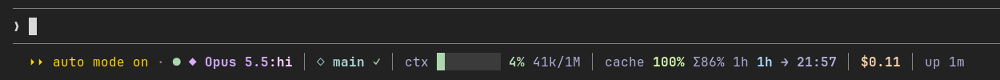

# neo-statusline


[English](README.md) | Русский

Статусбар Claude Code в одну строку под промптом:

```
● ◆ Sonnet 5.5:xhi │ ◇ main ~2 +1 ↑1 │ ctx ████░░░░ 13% 127k/1M │ cache 99% Σ98% 1h 42m → 20:45 │ 5h 21% (4h17m) │ 7d 7% (6d17h) │ $1.20 │ up 19m
```



*Снимок живой сессии сразу после второго запроса: префикс прочитан целиком (`100%`), итог по сессии `Σ86%`, кэш живёт час.*

| Сегмент | Что показывает |
| --- | --- |
| `●` / `◉` | простой / идёт ход |
| `◆ Sonnet 5.5:xhi` | модель и режим мышления (`lo`, `md`, `hi`, `xhi`, `max`) |
| `◇ main ~2 +1 ↑1` | ветка; `~` изменено, `+` добавлено, `-` удалено, `→` переименовано, `?` неотслеживаемое, `!` конфликты, `↑`/`↓` коммитов вперёд/назад, `✓` чисто |
| `ctx` | заполнение контекстного окна: полоска и число токенов |
| `cache` | prompt cache этой сессии: процент попаданий последнего запроса, `Σ` по всей сессии, `+Nk` записано последним запросом, `miss` если потерян закэшированный префикс, время жизни (`5m` / `1h`), сколько осталось и когда он остынет |
| `5h`, `7d` | окна лимитов и время до сброса |
| `agents 1/3` | работающие субагенты из всех запущенных в сессии |
| `$` | стоимость сессии |
| `up` | длительность сессии |

Полоски и проценты становятся жёлтыми, оранжевыми и красными по мере заполнения
(50 / 65 / 80%). На узком терминале часть деталей скрывается. Родная строка подсказок
движка остаётся ниже, но без напоминаний `(shift+tab to cycle)` и `N agents`.

## Субагенты

Откройте субагента из списка задач, и бар переключится на него: он строится по запросам
самого агента (в основном диалоге возвращается обычный):

```
◉ ⤷ Explore Scan the repo │ ◆ Haiku 5.5:hi │ ctx 33k │ cache 91% Σ47% +30k 1h 58m → 21:40 │ tok ↑2k in 2k cw 32k cr 30k │ 2 req │ session $1.20
```

| Сегмент | Что показывает |
| --- | --- |
| `◉` `●` `✓` `✗` | состояние агента: работает, простаивает, завершён, ошибка или остановлен |
| `⤷ Explore Scan the repo` | его тип и описание задачи |
| `◆ Haiku 5.5:hi` | собственные модель и effort агента, они могут отличаться от основных |
| `ctx` | токены в его окне сейчас; с полоской и процентом, если он работает на основной модели |
| `cache` | его собственный кэш, считается так же, как основной (последний запрос, `Σ`, `+Nk`, `miss`, отсчёт) |
| `tok` | всё, что он оплатил: `↑` вывод, `in` вход без кэша, `cw` записано в кэш, `cr` прочитано из кэша |
| `req` | сколько запросов он сделал |
| `session` | стоимость сессии: движок не ведёт учёт по агентам |

Агент, не сделавший ни одного запроса с загрузки мода, показывает `no requests seen yet`.
Числа каждого агента хранятся вместе с его сессией, как и основной кэш.

## Установка

В строке ввода Claude Code:

```text
/plugin install neo-statusline --marketplace Hoxiee/claude-code-mods
```

Подтвердите добавление marketplace клавишей `y`, затем выберите область установки
и настройки.

Мод рисует компонент `PromptHint`, поэтому нужен терминальный Claude Code с поддержкой
модов. Добавьте папку мода в `~/.claude/settings.json`:

```json
{
  "env": { "CLAUDE_CODE_PLUGIN_DIRS": "/path/to/neocc-mods/neo-statusline" },
  "pluginConfigs": { "neo-statusline": { "cacheTtl": "1h" } }
}
```

## Настройки

`cacheTtl`: время жизни prompt cache. Движок его не сообщает, поэтому `auto` (по
умолчанию) определяет его по попаданиям в кэш после паузы дольше пяти минут и до
появления доказательств показывает `5m?`. Значения `5m` и `1h` фиксируют его.

`showLimits` (галочка, по умолчанию включена): показывать окна лимитов подписки `5h` и `7d`.
Отключите, если их уже показывает другая программа, например панель. Лимит `spend` шлюза
это не затрагивает.

## Цифры кэша

Процент считается как `read / (read + записано + без кэша)` у **последнего запроса**, а не у
всего хода: ход суммирует все свои запросы, и это скрывает, что кэш делает сейчас. `Σ`
суммирует все запросы сессии. У каждой сессии свои числа, поэтому новая сессия или `/clear`
начинается с `cache —`, а не с чужого отсчёта. Запросы субагентов сюда не входят: у них
свой кэш, он виден при просмотре агента.

Низкий процент сразу после большого результата инструмента нормален (`+Nk` — новый текст,
который кладётся в кэш). Настоящий сбой — `miss`: прежний префикс не прочитался.

Полную картину сессии показывает `tools/ccache`, он читает её транскрипт:

```sh
ln -s "$PWD/tools/ccache" ~/.local/bin/ccache
ccache            # самая свежая сессия текущего каталога
ccache 82045d4f   # префикс id сессии
```

Он выводит каждый вызов API (новые / записанные / прочитанные токены), помечает запросы
`CACHE BREAK` и `COLD`, показывает процент по сессии и когда кэш истечёт.

## Проверка

```sh
claude plugin validate .
claude plugin test .
```

## Лицензия

[MIT](LICENSE) © 2026 Hoxiee. Иконка распространяется под той же лицензией;
редактируемый исходник — [assets/icon.svg](assets/icon.svg).
